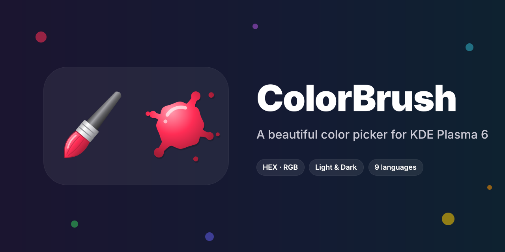
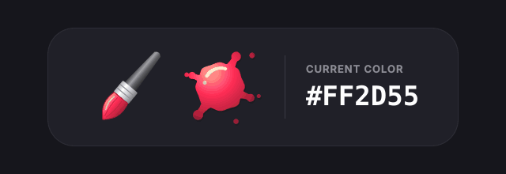
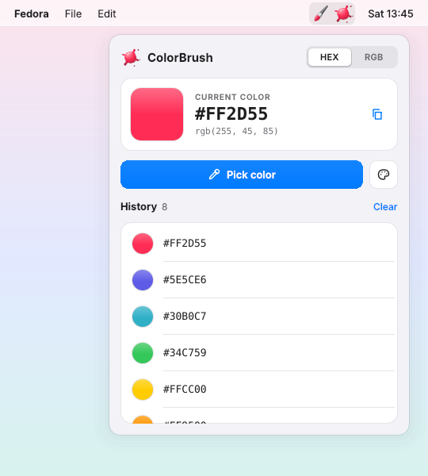
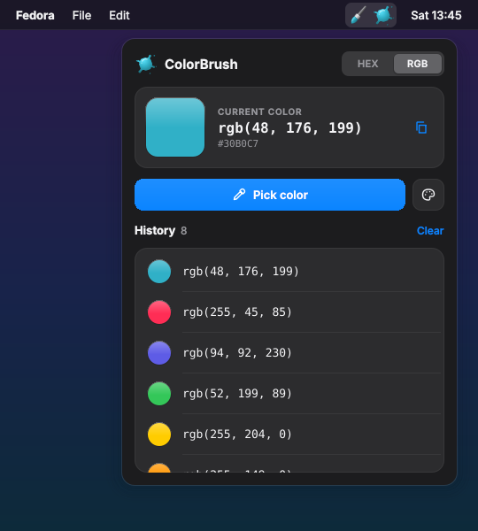
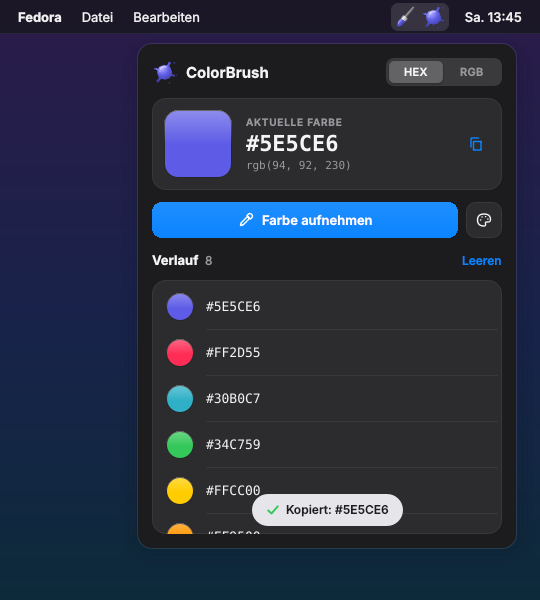

<div align="center">



<br>

[](https://kde.org/plasma-desktop/)
[](https://www.qt.io/)
[](LICENSE)
[](https://github.com/Swenix-dev/ColorBrush/releases/latest)

**A paint brush and a splat of paint in your panel.<br>Click the brush to pick any color on screen. Click the splat to see your history.**

[Features](#features) •
[Screenshots](#screenshots) •
[Installation](#installation) •
[Usage](#usage) •
[Languages](#languages) •
[FAQ](#troubleshooting)

</div>

---

<div align="center">
  
  <br>
  <sub>The bristles and the splat always take on the color you picked last.</sub>
</div>

<a id="features"></a>

## ✨ Features

|   |   |
|---|---|
| 🖌️ **One-click picking** | Click the brush and pick any pixel on your screen, on Wayland and X11. |
| 🎨 **Living icon** | The brush bristles and the paint splat fade into your last picked color. |
| 🕘 **Color history** | Up to 30 recent colors, newest first. Duplicates move to the top instead of piling up. |
| 🔁 **HEX ⇄ RGB** | A segmented switch shows every value as `#FF2D55` or `rgb(255, 45, 85)`. |
| 📋 **Instant copy** | A picked color goes straight to the clipboard. Click any history entry to copy it again. |
| 🌗 **Light & Dark** | Follows your Plasma color scheme with a clean, modern look. |
| 🌍 **Speaks your language** | The UI follows your system language: 9 languages are included. |
| 🎛️ **Manual picker** | Need a color that isn't on screen? Open the color dialog next to the pick button. |

<a id="screenshots"></a>

## 📸 Screenshots

<div align="center">
<table>
  <tr>
    <td align="center"></td>
    <td align="center"></td>
  </tr>
  <tr>
    <td align="center"><b>Light</b> · HEX values</td>
    <td align="center"><b>Dark</b> · RGB values</td>
  </tr>
</table>


<br>
<sub><b>System language German</b>: the whole UI switches automatically, including the “copied” toast.</sub>
</div>

<a id="installation"></a>

## 📦 Installation

### Option 1: Add Widgets dialog (recommended)

1. Download **`ColorBrush-x.y.z.plasmoid`** from the [latest release](https://github.com/Swenix-dev/ColorBrush/releases/latest).
2. Right-click your panel → **Add Widgets…** → **Get New Widgets** → **Install Widget From Local File…**
3. Pick the downloaded file, then search for **ColorBrush** and drag it into your panel.

### Option 2: Terminal

```sh
kpackagetool6 -t Plasma/Applet -i ColorBrush-1.3.0.plasmoid
```

To update later, use `-u` instead of `-i`.

### Option 3: From source

```sh
git clone https://github.com/Swenix-dev/ColorBrush.git
cd ColorBrush
./install.sh
```

`install.sh` installs or updates the widget and removes the old pre-release package (*ChromaBrush*) if it is still there.
To remove ColorBrush, run `./uninstall.sh`.

> [!TIP]
> After an update, reload Plasma so the new version is used:
> ```sh
> systemctl --user restart plasma-plasmashell
> ```

### Requirements

| Component | Notes |
|---|---|
| **KDE Plasma 6.0+** | Developed on Fedora 44 with Plasma 6.7 |
| **KWin** | Provides the screen color picker (Wayland and X11) |
| **`gdbus`** | Part of `glib2`, preinstalled on almost every distribution |
| **plasma5support** | Ships with Plasma 6 |

<a id="usage"></a>

## 🖱️ Usage

| Action | What happens |
|---|---|
| **Click the brush** | Starts the color picker right away. Click anywhere on screen; press <kbd>Esc</kbd> to cancel. |
| **Click the splat** | Opens the popup with the current color and your history. |
| **Click a history entry** | Copies the value in the active format (HEX or RGB). |
| **Hover a history entry** | Shows buttons to copy or delete that color. |
| **HEX \| RGB switch** | Changes how every value is shown and copied. The choice is remembered. |
| **Palette button** | Opens a color dialog to add a color by hand. |
| **Right-click the widget** | Pick color, switch HEX/RGB, or clear the history. |

<a id="languages"></a>

## 🌍 Languages

ColorBrush picks its language from your system settings. No configuration is needed.

| | Language | | Language | | Language |
|---|---|---|---|---|---|
| 🇬🇧 | English | 🇩🇪 | Deutsch | 🇫🇷 | Français |
| 🇪🇸 | Español | 🇮🇹 | Italiano | 🇳🇱 | Nederlands |
| 🇵🇱 | Polski | 🇧🇷 | Português (Brasil) | 🇹🇷 | Türkçe |

If your language is missing, ColorBrush falls back to English.
**Want to add yours?** It only takes a few minutes. See [`po/README.md`](po/README.md), then open a pull request or a [translation issue](https://github.com/Swenix-dev/ColorBrush/issues/new?template=translation.yml).

<a id="how-it-works"></a>

## ⚙️ How it works

ColorBrush is written entirely in QML. To read a pixel from the screen, it asks KWin over D-Bus:

```sh
gdbus call --session --dest org.kde.KWin \
  --object-path /ColorPicker --method org.kde.kwin.ColorPicker.pick
```

KWin shows its crosshair, you click, and KWin returns the color as an ARGB value.
ColorBrush converts it to HEX and RGB, stores it in the widget settings and copies it to your clipboard.
Nothing leaves your computer.

<a id="troubleshooting"></a>

## 🩺 Troubleshooting

<details>
<summary><b>The popup shows “Color picker failed”</b></summary>

<br>

Run the D-Bus command from [How it works](#how-it-works) in a terminal.
If it prints something like `(uint32 4294914389,)`, KWin works and you should [open an issue](https://github.com/Swenix-dev/ColorBrush/issues/new?template=bug_report.yml).
If it fails, check that you are running a KWin session (not another window manager).
</details>

<details>
<summary><b>The widget doesn't load or shows an error</b></summary>

<br>

Start it in its own window to see the log:

```sh
plasmawindowed org.seaq.colorbrush
```

Paste the output into a [bug report](https://github.com/Swenix-dev/ColorBrush/issues/new?template=bug_report.yml).
</details>

<details>
<summary><b>The widget is too narrow after updating from ChromaBrush</b></summary>

<br>

Remove the old widget from the panel and add **ColorBrush** again, so Plasma gives it room for both the brush and the splat.
</details>

## 🗂️ Project structure

```
ColorBrush/
├── package/                      # the plasmoid itself
│   ├── metadata.json
│   └── contents/
│       ├── config/main.xml       # settings: history, HEX/RGB, auto copy
│       ├── locale/               # compiled translations (.mo)
│       └── ui/
│           ├── main.qml          # panel icons, picker logic, clipboard
│           ├── FullView.qml      # the popup
│           ├── BrushIcon.qml     # vector paint brush
│           ├── Splat.qml         # vector paint splat
│           └── SegmentedControl.qml
├── po/                           # translation sources (.po / .pot)
├── scripts/                      # translation helpers
├── screenshots/
├── build.sh                      # builds ColorBrush-<version>.plasmoid
├── install.sh / uninstall.sh
└── CHANGELOG.md
```

## 🛠️ Building a release

```sh
./build.sh          # → ColorBrush-1.3.0.plasmoid
```

Pushing a tag like `v1.3.0` triggers the GitHub Actions workflow, which builds the `.plasmoid` and attaches it to a new release automatically.

## 🤝 Contributing

Bug reports, ideas and translations are very welcome. Please use the [issue templates](https://github.com/Swenix-dev/ColorBrush/issues/new/choose).
For code changes, fork the repo, create a branch and open a pull request.

## 📄 License

ColorBrush is free software, released under the **[GNU General Public License v2.0 or later](LICENSE)**.

<div align="center">
<br>
Made with 🎨 by <a href="https://github.com/Swenix-dev"><b>Swenix-dev</b></a>
<br><br>
<sub>If ColorBrush brightens your desktop, consider leaving a ⭐</sub>
</div>
